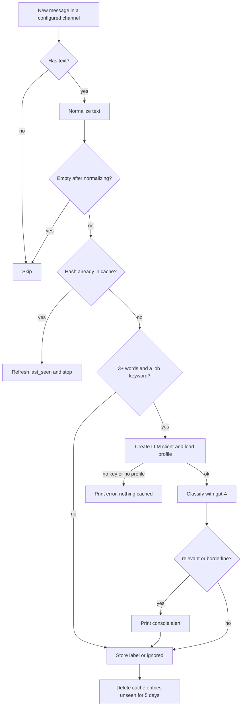

# Telegram CV/ML Job-Post Monitor

Watches Telegram tech-job channels for new posts, filters them with a keyword prefilter, and asks an LLM how well
each remaining post fits a candidate profile. Posts labeled `relevant` or `borderline` are printed as console
alerts. A separate exporter pulls recent channel messages into a CSV for manual labeling.

## How it works

The monitor (`telegram_ingestor.py`) processes each new message posted in the configured channels while it runs
(there is no backfill of older messages):



- **Normalization** lowercases the text, drops combining marks (e.g. Hebrew vowel points) and turns punctuation and
  emoji into spaces.
- **Deduplication** is an exact match on the SHA-256 hash of the normalized text. The SQLite cache stores hashes
  and labels, not message text.
- **Keywords** come from `config.JOB_KEYWORDS`. English keywords match whole words only (`ml` does not match
  `html`); Hebrew keywords also match with an attached prefix letter (ב, ל, ו …).
- **Classification** uses OpenAI `gpt-4` at temperature 0 and returns `relevant`, `borderline` or `not_relevant`.
  Only `relevant` and `borderline` produce an alert; everything else is stored as `ignored`.

### Failure handling

Classification can fail in two different places:

- **During the API call** – network errors, an invalid key, rate limits, an empty or unexpected answer: the
  classifier prints the error (if any) and returns `not_relevant`. The message is stored as `ignored`, so an
  identical repost is deduplicated and not classified again.
- **Before the API call** – a new classifier is created for every message that reaches the LLM. If no OpenAI key is
  set at all, the OpenAI client refuses to start; if `profile.txt` is missing, loading the profile fails. Either
  error reaches the message handler, which prints `Error handling message: …`. Nothing is alerted or cached, so the
  same text is processed again if it reappears.

Example alert (time in the machine's local time zone, message shown normalized):

```
[ALERT] Relevant job in Example Jobs Channel, posted 16.11 13:02
Sender: Example Recruiter
Message: computer vision algorithm engineer pytorch
```

## Requirements

- Python 3.13 or newer (if missing, `uv python install 3.13` can provide it)
- [uv](https://docs.astral.sh/uv/)
- Telegram API credentials from [my.telegram.org/apps](https://my.telegram.org/apps)
- An OpenAI API key and a local `profile.txt` — needed by the monitor only

| | Exporter | Monitor |
|---|---|---|
| `TELEGRAM_API_ID` (must be a number) | required — checked when `config.py` is imported | required — same check |
| `TELEGRAM_API_HASH` | required for Telegram sign-in | required for Telegram sign-in |
| `OPENAI_API_KEY` | not used | not checked at startup; see [Failure handling](#failure-handling) |
| `profile.txt` | not used | not checked at startup; see [Failure handling](#failure-handling) |

## Setup

All commands below are PowerShell and run **from the project root**.

```powershell
git clone https://github.com/xYaelx/JobAlert.git
Set-Location JobAlert
uv sync
```

### Settings (`.env`)

Create `.env` in the project root (gitignored) with:

```env
TELEGRAM_API_ID=your_api_id
TELEGRAM_API_HASH=your_api_hash
OPENAI_API_KEY=your_openai_key
```

`config.py` calls `load_dotenv()`, which searches for `.env` starting in the folder that contains `config.py` and
then its parent folders — not the folder you run from. Everything else uses the **current folder**: the Telegram
session (`session.session`), the cache (`messages_cache.db`) and the export (`jobs_messages.csv`). Running from
the project root keeps them all in one place and reuses the same Telegram sign-in.

### Candidate profile

```powershell
Copy-Item profile.example.txt profile.txt
```

Then open `profile.txt` and replace **all** of its text — including the instruction lines at the top and every
`<placeholder>` — with your own description (role, experience, target roles, locations, what counts as a good or
borderline fit). The whole file is inserted into the LLM prompt as-is. `profile.txt` is gitignored; the tracked
prompt in `llm_classifier.py` is a generic template with a `{profile}` placeholder.

### Channels and keywords (`config.py`)

Public channels can be listed by username, private channels you belong to by their numeric ID:

```python
TARGET_CHANNELS = {
    '@example_public_channel': 'Example public channel',
    -1000000000000: 'Example private channel',  # fictional placeholder; use your channel's ID
}

JOB_KEYWORDS = ["computer vision", "deep learning", "pytorch"]  # shortened; see config.py for the full list
```

Join the channels you want to monitor with the Telegram account you sign in with.

## Usage

### Telegram sign-in

The first run of either command signs in to Telegram in the terminal: it asks for your phone number, then the
login code Telegram sends you, and — only if your account has two-step verification — your password. The session
is saved as `session.session` in the current folder and reused by both commands afterwards. Never share the code,
password or session file.

### Run the monitor

```powershell
uv run python -m telegram_ingestor
```

It prints `Listening to Telegram channels...` and then alerts as matching posts arrive. Stop it with `Ctrl+C`.

### Export messages for labeling

```powershell
uv run python export_messages.py
```

Writes the last 100 text messages from each configured channel to `jobs_messages.csv` with the columns `channel`,
`date` (UTC), `text` and an empty `label` column for you to fill in. The file is UTF-8 with BOM so Excel shows
Hebrew correctly.

**Existing exports are protected by default.** If `jobs_messages.csv` already exists, the exporter stops with a
message before contacting Telegram and leaves the file untouched. To replace it on purpose:

```powershell
uv run python export_messages.py --force
```

> ⚠️ `--force` overwrites `jobs_messages.csv`, **including every label you have added**. Move or rename a labeled
> file first.

The new file is written only after all messages were fetched, so a failed fetch leaves an existing file as it was.
The existence check happens *before* the fetch, though: a file created at the same path while the export runs
would still be overwritten.

## Data hygiene

Credentials, Telegram sessions, `profile.txt`, the SQLite cache (including its WAL files) and `jobs_messages.csv`
are gitignored. Renamed or labeled copies of the export are ignored **only at the repo root** and only when named
`jobs_messages*.csv`, `*labeled*.csv` or `*labelled*.csv` (lowercase or capital first `L`). Anything else, such as
`data/jobs_labeled.csv`, is not ignored.

- Keep labeled datasets **outside the repository**.
- To see whether a path matches an ignore rule: `git check-ignore -v --no-index path\to\file.csv`. No output means
  no rule matches, so `git add` would include the file. A match only keeps new files out: it does not untrack a
  file that is already committed and says nothing about what the Git history contains.

## Tests

```powershell
uv run pytest
```

No `.env`, Telegram account, OpenAI key or `profile.txt` is needed. `tests/conftest.py` sets dummy settings,
disables `.env` loading, runs each test in a temporary folder and blocks non-loopback connections made through
Python's `socket` module. That guard catches accidental network calls from Python code; it does not cover native
extensions or subprocesses. Telegram and OpenAI clients are replaced by fakes or never called.

## Project structure

```
config.py               channels, job keywords, settings from .env
telegram_ingestor.py    monitor: Telegram listener and processing pipeline
text_processor.py       normalization and keyword prefilter
db.py                   SQLite dedup cache
llm_classifier.py       profile loading and LLM classification
notifier.py             console alerts
export_messages.py      CSV export for labeling (with overwrite protection)
profile.example.txt     template for your local, gitignored profile.txt
tests/                  pytest suite and test isolation (conftest.py)
```

## Planned

- Evaluate the classifier with [DeepEval](https://github.com/confident-ai/deepeval) against a manually labeled set
  built with the exporter. Not implemented yet.

## Author

[xYaelx](https://github.com/xYaelx)
